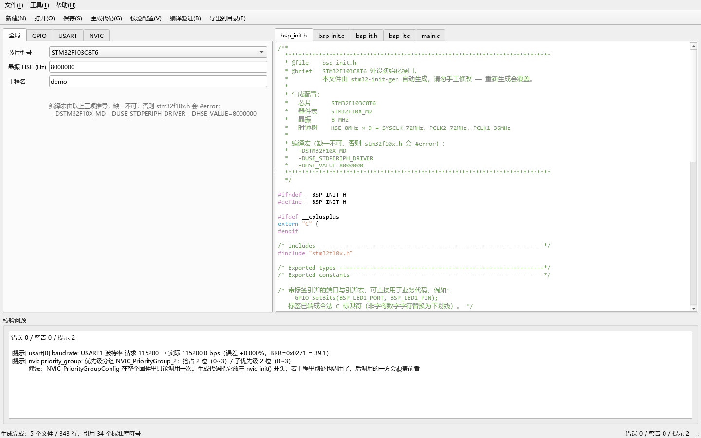
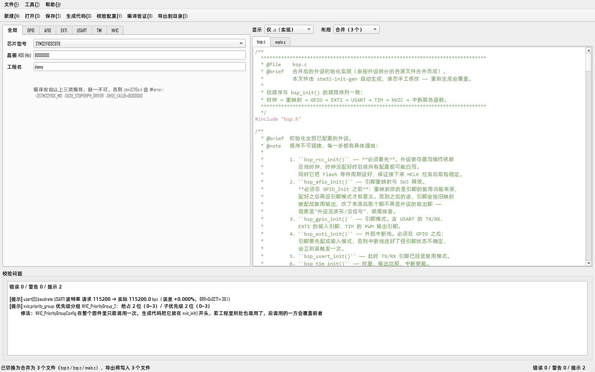
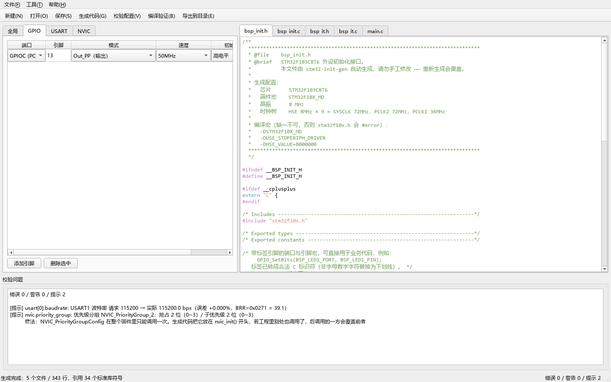
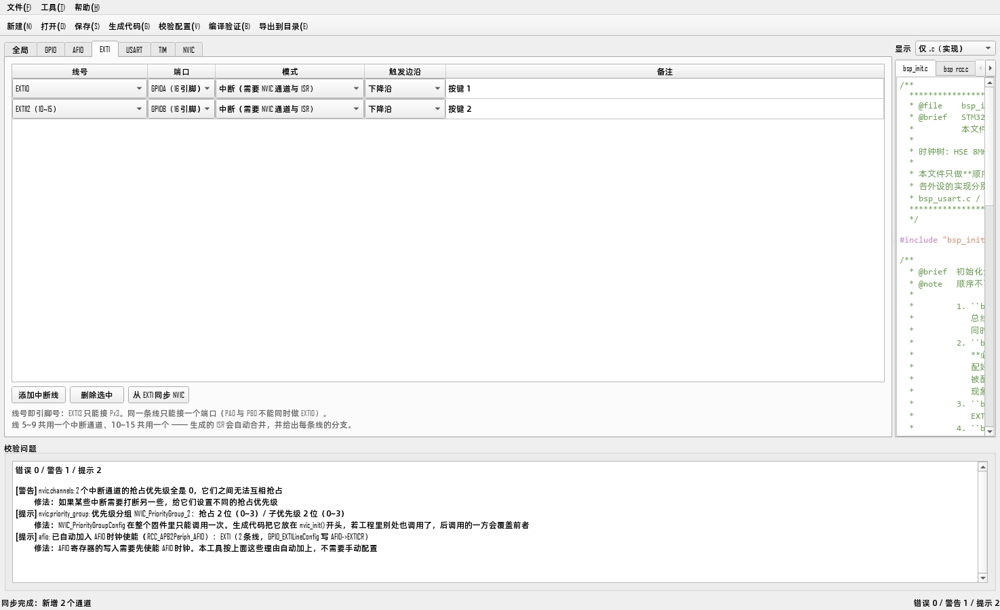
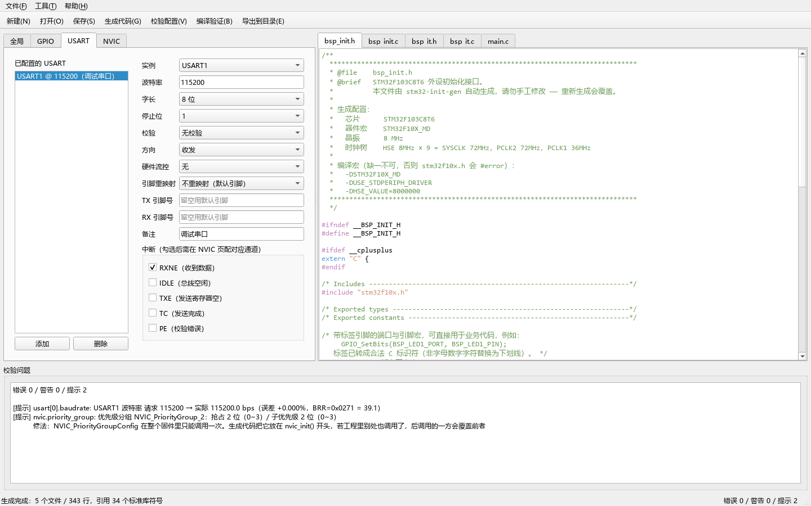
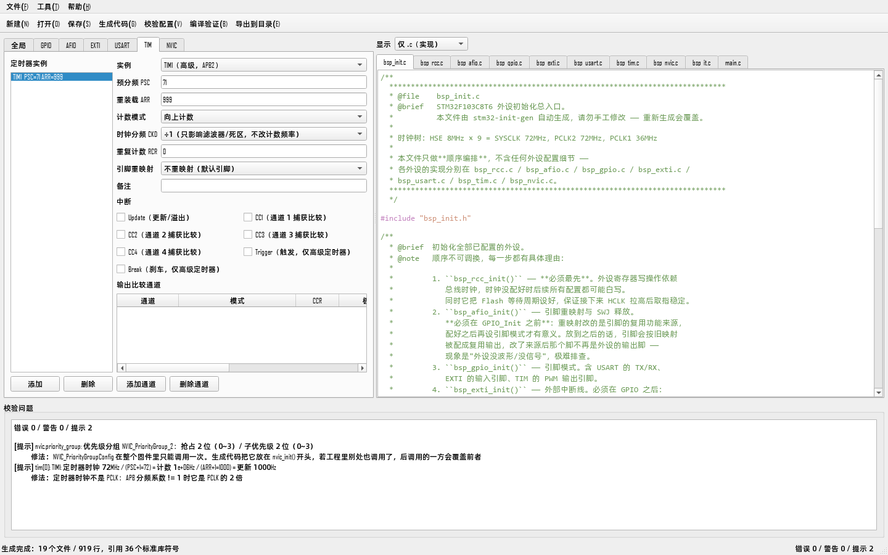
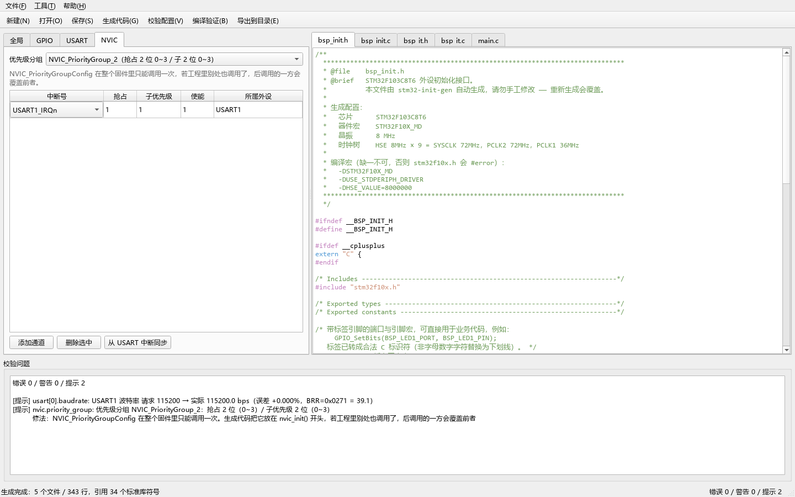
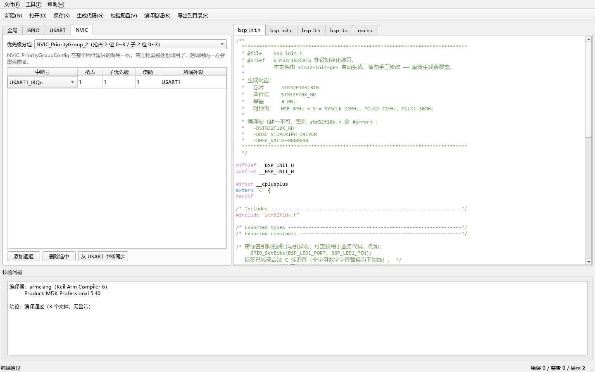

# GUI 使用说明

> 界面是独立项目 `stm32-init-gen-gui`，核心库在同级的 `stm32-init-gen`。
> 两个项目共用一个虚拟环境（在核心库那边建）。

## 启动

**最省事：双击项目根目录的 `启动GUI.cmd`。** 它用 `pythonw.exe` 启动，不弹黑窗口，
也不会在后台留一个控制台。脚本内路径都相对脚本自身解析，在哪儿双击都行。

**想要桌面图标**：双击 `create-shortcut.cmd`，桌面上会出现「STM32 初始化代码生成器」，
图标是深蓝底 + 芯片 + 两条方波。快捷方式直接指向 `pythonw.exe -m stm32gen_gui`，
连控制台闪一下都不会有。

命令行方式：

```powershell
cd D:\Documents\deepseek-harness\default-workspace\stm32-init-gen-gui

stm32-init-gui              # 入口脚本（需先激活虚拟环境）
# 或
python -m stm32gen_gui
```

没先激活虚拟环境的话，直接用完整路径也行：

```powershell
& '..\core\.venv\Scripts\python.exe' -m stm32gen_gui
```

> 首次使用先把界面项目装上（在它自己的目录里）：
> `python -m pip install --no-build-isolation -e .`
> 装完 `python -m stm32gen_gui --selfcheck` 可检查核心库、桥接层、Qt 是否齐备。

启动后会**自动载入示例配置**（PC13 输出接 LED + USART1 @115200 开 RXNE 中断），
所以一打开就能看到完整效果，不用从空白开始。

## 界面总览



界面分三块：

| 区域 | 作用 |
|---|---|
| **左侧配置区** | 七个页签：全局 / GPIO / AFIO / EXTI / USART / TIM / NVIC。改这里 |
| **右侧代码预览** | **默认只显示 .c**（10 个），可切到「仅 .h」或「全部」。带 C 语法高亮 |
| **底部校验问题** | 实时列出错误 / 警告 / 提示 |

**左侧一改，右侧立刻重新生成** —— 不需要点任何「刷新」按钮。
窗口最右下角是实时摘要（如「错误 0 / 警告 0 / 提示 2」）。

### 预览的显示筛选

预览区左上角有个「显示」下拉，三档：

| 选项 | 页签数 | 用途 |
|---|---|---|
| **仅 .c（实现）** | 10 | **默认**。要读、要手改业务逻辑的就是这些 |
| 仅 .h（接口与宏） | 9 | 看 `BSP_LED1_PIN` 这类给业务代码用的宏、确认函数签名 |
| 全部 | 19 | 逐文件通读 |

默认只显示 `.c` 是因为 19 个页签平铺时，找 `bsp_usart.c` 得先在 `.h`/`.c`
交错的一排里数一遍。

> **切配置页时预览会自动跟过去。** 左侧切到哪个外设，右侧就跳到它生成的
> `.c`（GPIO → `bsp_gpio.c`、TIM → `bsp_tim.c`，「全局」→ `bsp_init.c`）。
> 反过来不成立：你自己点预览页签不会被抢回去，那是在读代码。

> **筛选只影响显示，不影响导出。** 无论当前停在哪个分组，「导出到目录」
> 都会写出全部 19 个文件 —— 否则生成的 Keil 工程会缺头文件而编译不过，
> 而且现象很隐蔽（只是在包含路径里找不到 `.h`）。这条有测试守着
> （`test_window_export_writes_all_files_regardless_of_filter`）。

### 产物布局：分文件 / 合并

「显示」下拉右边还有一个**「布局」**下拉：

| 选项 | 导出文件数 | 用途 |
|---|---|---|
| **分文件（19 个）** | 19 | **默认**。删外设时不留孤儿代码 |
| 合并（3 个） | 3 | `bsp.h` + `bsp.c` + `main.c`，不想往工程里塞 19 个文件时用 |



它和「显示」不是一回事，别混：

- **「显示」是筛页签**，不重跑生成，也不影响导出。
- **「布局」是换产物形态**，会重新生成，导出写的文件数跟着变（状态栏会说明）。

放在预览区而不是配置区，因为它属于「怎么给」而不是「配什么」—— 两种形态
出自同一份配置，切换不用重新填表，也不会丢你填的东西。

> 合并布局下，切左侧配置页时预览总是跳到 `bsp.c`。这不是失灵：全部实现
> 确实都在那一个文件里，配置页与文件不再一一对应。

两种布局的正文是同一套模板渲染出来的，合并只是省掉文件级脚手架，
所以行为完全一致 —— 都是零警告编译通过的。

## 七个配置页

### 1. 全局


| 字段 | 说明 |
|---|---|
| **芯片型号** | C8T6（64KB Flash / 20KB RAM）或 C6T6（32KB / 10KB） |
| **晶振 HSE** | 单位 Hz。默认 `8000000` |
| **工程名** | 进注释，只允许字母数字下划线连字符 |

下面那行灰字是**编译宏**——它由上面三项推导，会自动更新：

```
-DSTM32F10X_MD -DUSE_STDPERIPH_DRIVER -DHSE_VALUE=8000000
```

> **这三项缺一不可**，少任何一个 `stm32f10x.h` 都会直接 `#error`。
> 把它们照抄到 Keil 的 `C/C++ → Define` 里。

**晶振填错会怎样**：库的 `SetSysClockTo72()` 硬编码 PLL ×9，
所以填 12MHz 会得到 108MHz 主频（超频）。工具会立刻在底部报错拦下你。

### 2. GPIO



表格每行一个引脚。单元格里是**下拉框**，不用记宏名，也打不出非法值：

| 列 | 可选值 |
|---|---|
| 端口 | **只列出该芯片封装上真实存在的端口，标签带引脚数**：`GPIOA（16 引脚）`/`GPIOB（16 引脚）`/`GPIOC（3 引脚）`/`GPIOD（2 引脚）` |
| 引脚 | **列出该端口全部可用引脚，被晶振/调试口占用的会标注**：`13`、`14（OSC32_IN）`、`0（OSC_IN）` |
| 模式 | 8 种，带「输入/输出/复用」分类标注 |
| 速度 | 10MHz / 2MHz / 50MHz |
| 初始电平 | 低电平 / 高电平 |
| 备注 | 自由文本，只进注释。**会影响生成的宏名**（见下） |

**引脚列表跟着端口走**：把端口从 GPIOA 改成 GPIOC，引脚列立刻只剩 13/14/15。
换端口时**能保留就保留引脚号** —— 从 PA13 改到 PB13 不用重新选一次引脚。
只有新端口没有那个号时才回退到第一个可用值（比如 PA15 → GPIOD 只能落到 0）。

**被占用的引脚仍然可选，只是标注出来**。这是刻意的：它们在电气上确实可用
（板子没焊晶振时 PD0 完全可以当普通 IO 做输出）。直接隐藏会让你以为工具漏了
引脚；标注出来则把取舍交给你，同时把风险讲清楚。

**换芯片会重建这两列**。LQFP48 上没有 GPIOE/F/G，所以下拉里根本不会出现
——选了就会报错的选项不该给出来。

> 引脚列的选项由芯片封装推导（`bridge.pin_options`），数据来源是
> `models/chip.py` 的 `ChipSpec.ports` 与 `reserved`。

**备注不是纯装饰**：填了备注的引脚会生成 `BSP_xxx_PORT` / `BSP_xxx_PIN` 宏，
可以直接在业务代码里用：

```c
/* PC13 — LED1 低电平点亮 */
#define BSP_LED1_PORT      GPIOC
#define BSP_LED1_PIN       GPIO_Pin_13
```

中文备注会自动转成合法标识符（非字母数字字符替换为下划线）。

**两个自动行为**：

- 输入模式会自动忽略「初始电平」（下拉框没意义了）
- 输出模式**必须**给初始电平，否则底部报错——因为上电瞬间电平不确定，
  这是「上电抖一下」的典型来源

「添加引脚」/「删除选中」在表格下方。

### 3. AFIO

AFIO 在本工具里只管**一件事**：SWJ 调试口释放。引脚重映射在各自的外设页里选
（USART 页有「引脚重映射」，TIM 页也有），生成时代码统一放进 `bsp_afio.c`。

| 选项 | 释放的引脚 | 风险 |
|---|---|---|
| 不释放（默认） | 无 | 无，调试最安全 |
| 只关 JTAG，保留 SWD | PA15 / PB3 / PB4 | 无，仍可用 SWD 下载调试 |
| **关闭 SWD + JTAG** | PA13 / PA14 / PA15 / PB3 / PB4 | **调试器再也连不上**，只能靠 BOOT0 或整片擦除救回 |
| 只关 NJTRST | PB4 | 无 |

选「关闭 SWD + JTAG」时底部会报**错误**（不是提示）——这是全工具唯一一处
不可逆操作层面的风险，必须在选的那一刻就看见。

### 4. EXTI



表格每行一条外部中断线。线号与端口都是下拉框：

| 列 | 说明 |
|---|---|
| 线号 | 0~15，标签标注所属中断通道（5~9 共享 `EXTI9_5_IRQn`，10~15 共享 `EXTI15_10_IRQn`） |
| 端口 | 该线接哪个端口。**线号即引脚号** —— EXTI3 只能是 Px3 |
| 模式 | 中断（需 NVIC + ISR）/ 事件（不产生中断） |
| 触发边沿 | 上升沿 / 下降沿 / 双边沿 |
| 备注 | 进注释 |

**两条硬件约束，工具会拦**：

- **同一条线只能接一个端口**。`AFIO->EXTICR` 每条线只有一份端口选择，
  PA0 与 PB0 不能同时做 EXTI0 —— 后写的会覆盖先写的，表现为其中一个中断永不触发。
- **EXTI 引脚必须配成输入**。配成输出时中断永远不触发。

**「从 EXTI 同步 NVIC」按钮**：与 USART 那个同理，按中断模式的 EXTI 线自动补齐
NVIC 通道，已存在的不会重复添加。

### 5. USART



左侧是已配置实例列表，右侧是这个实例的参数。先点列表选中，再改右侧。

| 字段 | 说明 |
|---|---|
| 实例 | USART1 / USART2 / USART3（本芯片只支持这三个） |
| 波特率 | 手填。填完立刻显示**实际波特率与误差** |
| 字长 | 8 位 / 9 位 |
| 停止位 | 1 / 0.5 / 2 / 1.5 |
| 校验 | 无 / 偶 / 奇 |
| 方向 | 收发 / 只接收 / 只发送 |
| 硬件流控 | 无 / RTS / CTS / RTS+CTS |
| 引脚重映射 | 见下 |
| TX/RX 引脚号 | **留空用默认引脚** |
| 备注 | 进注释 |
| 中断 | 复选框：RXNE / IDLE / TXE / TC / PE |

**波特率误差怎么来的**：不是套公式，是逐行复现了 `USART_Init()` 里的整数
运算。所以看到的是**实际会发生**的误差，不是理论值。例如：

```
[提示] usart[0].baudrate: USART1 波特率 请求 115200 → 实际 115200.0 bps
       （误差 +0.000%，BRR=0x0271 = 39.1）
```

**重映射**：LQFP48 封装下只有 `USART1 → PB6/PB7` 可用。选了
`USART3_PARTIAL` 之类会立刻报错，因为目标引脚 `PC10/PC11` 在这封装上不存在。

**字长的坑**：`USART_WordLength` 指的是**含校验位的帧位数**。所以
「8 位 + 校验」实际只有 7 个数据位，工具会拦下并提示改用 9 位（即常见的 8E1/8O1）。

### 6. TIM



TIM 页是「左列表 + 右表单 + 通道子表」：

左侧是已配置的实例（TIM1~TIM4）。点「添加」会挑一个还没用过的实例；
右侧是这个实例的参数与中断；下方是该实例的输出比较通道表。

| 字段 | 说明 |
|---|---|
| 实例 | TIM1（高级）/ TIM2~4（通用）。中容量只有这四个 —— TIM5~7 的中断号在标准库里不存在 |
| 时钟源 | 内部时钟（时钟树）/ ETR 引脚 / TI 捕获通道 / ITR 级联。选外部时见下方「外部时钟」一节 |
| 预分频 PSC | 内部时钟下：计数频率 = 定时器时钟 / (PSC+1)。外部时钟下分的是外部脉冲 |
| ETR 预分频 / 极性 / 滤波 | **仅外部时钟可见**。ETR 预分频叠在 PSC 之上，两级串联 |
| 外部时钟频率 | Hz，**可留空**。只影响注释与实际频率回显，不影响生成的 PSC/ARR |
| 重装载 ARR | 更新频率 = 计数频率 / (ARR+1) |
| 期望周期/频率 + 自动计算 | 从结果反推 PSC/ARR，见下方「反算」一节 |
| 计数模式 | 向上 / 向下 / 中央对齐 1~3。**中央对齐下更新频率再减半** |
| 时钟分频 CKD | **只影响滤波器与死区的时间基准，不改计数频率** —— 想改周期请改 PSC |
| 重复计数 RCR | 仅 TIM1 有效（通用定时器没有 RCR 寄存器） |
| 引脚重映射 | 选项随实例变化：TIM4 没有部分重映射，TIM2 有两种 |
| 中断 | Update / CC1~CC4 / Trigger / Break。后两者仅 TIM1 有效 |

通道子表的列：通道 / 模式 / CCR / 极性 / 预装载 / 输出使能 / 端口 / 引脚 / 备注。

**三个关键点**：

1. **定时器时钟不是 PCLK**。APB 分频系数 ≠ 1 时它是 PCLK 的 2 倍 ——
   36MHz 的 PCLK1 对应 72MHz 的 TIM2 时钟，算周期时差一倍。底部面板会把
   算出来的频率直接列出来，对着示波器一眼能核对。
2. **PWM 必须开预装载**。不开的话改 CCR 会在计数器跑到一半时立刻生效，
   可能产生一个残缺脉冲（示波器上的窄毛刺就是这么来的）。
3. **TIM1 必须开主输出 MOE**。`BDTR.MOE` 复位值是 0，不开则 PWM 引脚
   完全没有波形 —— 这是高级定时器最常见的「配置都对了但没输出」原因，
   工具会自动生成 `TIM_CtrlPWMOutputs`。

**端口/引脚留空**表示该通道的引脚由你在别处配置（比如还要兼作别的复用），
此时工具只配定时器本体、不生成 `GPIO_Init`。填了端口就必须同时填引脚，
只填一个会被拦下（否则 GPIO 配置会被静默跳过）。

#### 外部时钟：脉冲不来自时钟树

「时钟源」下拉默认是**内部时钟**（时钟树来的 TIMxCLK）。换成外部时钟后，
计数脉冲来自引脚或另一个定时器，频率不再由时钟树决定：

| 选项 | 计数脉冲来自 | 占引脚 |
|---|---|---|
| 外部 ETR 引脚（模式1 / 模式2） | TIMx_ETR 专用引脚 | ETR |
| 外部 TI1 / TI2 引脚 | 捕获通道 CH1 / CH2 的边沿 | CH1 / CH2 |
| 外部 TI1 引脚（双边沿） | CH1 的上升**和**下降沿 —— 一个周期数 2 次 | CH1 |
| 级联 ITR0~ITR3（片内） | 另一个定时器的更新事件 | 不占 |

**选外部时钟后，PSC/ARR 得你自己填** —— 「期望周期/频率」输入框和
「自动计算」按钮会自动禁用。理由很直接：工具不知道你接了什么信号源，
反算只能靠猜；猜错的 PSC/ARR 会产出一份「看着配置完整、实际频率差
几个数量级」的定时器配置，比明确要求手填危险得多。

外部时钟下多出四个输入项（内部时钟下全部隐藏）：

| 输入 | 说明 |
|---|---|
| ETR 预分频 | ÷1 / ÷2 / ÷4 / ÷8，**叠加在 PSC 之上**。两级串联：`外部频率 ÷ ETR ÷ (PSC+1)` |
| ETR 极性 | 不反相 / 反相。只对 ETR 模式有意义 |
| 外部信号滤波 | 0~15 次采样，0 表示不采样。抖动大的信号调大，代价是响应变慢 |
| 外部时钟频率 | 单位 Hz，**可以留空** |

「外部时钟频率」留空不影响生成 —— 它只用于两件事：

- 底部校验面板与生成注释里给出推算（如「1000Hz ÷4 ÷1 = 计数 250Hz，
  ÷250 = 更新 1Hz」）
- 让你在改 PSC/ARR 时立刻看到实际的更新频率

留空时回显写「频率未知」，**不会拿时钟树的 72MHz 顶替**。那个值对外部
计数毫无作用，写出来会诱导你按它推算周期，结论全错。

ITR 级联还有一条额外依赖：**上游定时器必须同时在运行**，否则本定时器
根本不计数。`ITR0~ITR3` 到底对应哪个上游由芯片型号决定（本工具没有
数据手册），底部会提示你对照参考手册的「TIM 内部触发连接」表。

#### 反算：给周期，让工具算 PSC/ARR

一般人是「我要 20ms 进一次中断」，而不是「我要 PSC=23、ARR=59999」。
所以 PSC/ARR 下方有一个**期望周期/频率**输入框和「自动计算」按钮：

| 输入 | 含义 |
|---|---|
| `1000` / `1kHz` / `20kHz` | 更新频率（无单位按 Hz 处理） |
| `20ms` / `0.5s` / `2.5s` | 更新周期 |

点了之后工具把算出的 PSC/ARR **直接填进上面的两个输入框**（不是只给建议，
你可以再手动微调），旁边的灰字会回显实际结果，例如：

```
PSC=23 ARR=59999 → 更新 50Hz（周期 20ms），零误差
```

三条设计取舍：

1. **先让 ARR 撑大，再让 PSC 兜底**。同一个目标频率往往有多种
   (PSC, ARR) 组合，工具优先选 ARR 最大的那个 —— ARR 决定占空比档位数，
   `ARR=59999` 能给出 0.0017% 的分辨率，而 `ARR=599` 只有 0.17%。分辨率
   不够时你会看到「CCR 改一位、占空比跳一大截」。
2. **除不尽就如实报误差**，例如求 777Hz 会给出最接近的解并注明误差百分比。
   它不会假装精确 —— 假装精确的后果是你照着注释算占空比，实测对不上。
3. **中央对齐会自动减半**。中央对齐一个完整周期上下各数一遍，同样的
   PSC/ARR 频率只有一半，所以反算要先把目标总分频折半。回显里会写明
   `÷2（中央对齐）`。

反算用的定时器时钟和生成代码用的是同一个（见上面第 1 点：APB 分频 ≠1 时
是 PCLK 的 2 倍），两者不会各自算一套。

**晶振改过之后重新点一次自动计算**。反算取的是「全局」页填的 HSE ——
8MHz 晶振配 PLL×9 得到 72MHz 定时器时钟，12MHz 晶振则是 108MHz，
同样的 PSC/ARR 频率差 1.5 倍。回显里的 `时钟 xxMHz` 就是当前实际取的
时钟，改完晶振时它也会跟着变，可以直接核对。

### 7. NVIC



| 列 | 说明 |
|---|---|
| 中断号 | 下拉框，选项**从标准库 `IRQn_Type` 读出**，不可能是库里没有的 |
| 抢占 | 优先级数值 |
| 子优先级 | 优先级数值 |
| 使能 | 1 = 使能，0 = 禁用 |
| 所属外设 | 备注用 |

**优先级分组**决定抢占/子优先级各占几位：

| 分组 | 抢占 | 子优先级 |
|---|---|---|
| GROUP0 | 0 位（只能 0） | 4 位（0~15） |
| GROUP1 | 1 位（0~1） | 3 位（0~7） |
| **GROUP2** | 2 位（0~3） | 2 位（0~3） |
| GROUP3 | 3 位（0~7） | 1 位（0~1） |
| GROUP4 | 4 位（0~15） | 0 位（只能 0） |

填超范围会立刻报错。选 GROUP4 却把子优先级填 3 就会被拦下。

**两个同步按钮**：中断生效要两步 —— `XXX_ITConfig` 开外设侧、`NVIC_Init` 开通道。
只做前者是最常见的手误，所以有两个按钮按配置自动补齐，已存在的不会重复添加：

| 按钮 | 按什么补 | 一个实例加几行 |
|---|---|---|
| 从 USART 中断同步 | 勾了中断的 USART | 1 行（`USARTx_IRQn`） |
| 从 TIM 中断同步 | 勾了中断的 TIM | 1 行（`TIMx_IRQn`；TIM1 是 `TIM1_UP_IRQn`） |

TIM 一个实例只加**一行**：TIM1~TIM4 的更新事件各只有一个向量，勾了 Update + CC1 + CC2
也是进同一条 NVIC 通道。按中断个数逐条加会插出重复行，校验层反而报冲突。

「中断号」下拉里能选到 USART / EXTI / TIM 三类。选项从标准库 `IRQn_Type` 按前缀
读出来，所以不会出现编造的名字 —— 比如中容量型号没有 `TIM5_IRQn`，下拉里也就没有。

## 底部校验面板



实时的错误 / 警告 / 提示。三级含义：

| 级别 | 含义 | 会拦生成吗 |
|---|---|---|
| **错误** | 必然产出不能用的代码 | ✅ 会。预览切成「错误」页 |
| **警告** | 能工作但有风险 | ❌ 不会 |
| **提示** | 参考信息（如波特率误差） | ❌ 不会 |

每条都带**修法**，例如：

```
[错误] gpio[0]: PA9 有多个输出驱动源：GPIO PA9（Out_PP）、USART1 TX（TX）
       修法：同一时刻一个引脚只能有一个输出驱动源 —— 两个外设同时推挽输出
             会电气打架。把 PA9 上多余的输出删掉，或给相关外设换引脚/换重映射
```

引脚复用**按方向分级**，不是见重就报：

| 情形 | 级别 | 原因 |
|---|---|---|
| 两个以上**输出**撞一个引脚 | 错误 | 两个外设同时推挽输出会电气打架 |
| **模拟**（如 ADC）和数字功能撞一个引脚 | 错误 | `GPIO_Mode_AIN` 会关掉数字输入缓冲，模拟是独占的 |
| 一个**输出**加若干**输入** | 警告 | 能跑，但输入读到的是本引脚自己的输出波形 |
| 多个**输入**共用 | 不报 | 合法。F1 的外设输入硬连线到引脚，各输入通道都能读到同一电平 |

修好之后预览会自动恢复。

## 工具栏与快捷键

| 按钮 | 快捷键 | 作用 |
|---|---|---|
| 新建 | `Ctrl+N` | 清空为空白配置 |
| 打开 | `Ctrl+O` | 读 `.json` / `.yaml` |
| 保存 | `Ctrl+S` | 存回原文件；没有路径时转为「另存为」 |
| 生成代码 | `Ctrl+G` | 刷新预览 |
| 校验配置 | `Ctrl+R` | 弹窗列出全部问题 |
| **编译验证** | `Ctrl+B` | 用真实编译器验证（见下） |
| 导出到目录 | `Ctrl+E` | 把当前布局的**全部文件**（19 个或合并的 3 个）写到磁盘（与预览筛选无关） |
| 复制当前文件 | `Ctrl+Shift+C` | 当前预览页内容进剪贴板 |

## 编译验证（`Ctrl+B`）

把当前配置生成的代码交给真实编译器过一遍，结果写进底部面板：

```
编译器：armclang（Keil Arm Compiler 6）
         Product: MDK Professional 5.40
结论：编译通过（3 个文件，无警告）
```

**在临时目录里做**，不会在你指定的输出目录留任何文件——它是只读性质的检查，
你可以先验证再决定导出。

支持四种编译器，按优先级自动选：

| 编译器 | 检查范围 | 结果措辞 |
|---|---|---|
| armclang（Keil AC6） | 真实目标编译 | 「编译通过」 |
| armcc（Keil AC5） | 真实目标编译 | 「编译通过」 |
| arm-none-eabi-gcc | 真实目标编译 | 「编译通过」 |
| 宿主 gcc（降级） | 仅语法 | 「语法检查通过」+ 警告 |

如果只找到宿主 gcc，面板里会明确写出：

```
注意：这是宿主 gcc 的语法检查，只能发现预处理、语法与
架构无关的类型问题，发现不了 ARM 专属问题（内联汇编、
寄存器类型、intrinsic 等）。
```

**不会**把降级结果说成「编译通过」——那会给人虚假信心。

## 「导出到目录」

选一个目录，把当前布局的全部文件（默认 19 个）写出去。目录有同名文件时会问：

- 选「是」→ 覆盖
- 选「否」→ 跳过它们，只写新文件

对话框**起始位置**是源码树旁边的成果目录 `stm32-init-gen-output\`
（工具与成果分开放，见核心库 README 的「目录结构」）。不要选进 `src\` 或仓库根 ——
那里不该有产物，一旦落进去就会被 git 追踪、被 ruff 扫到。

如果当前配置有阻断性错误，会先警告「生成的代码很可能不能用，仍要导出吗？」。

## 导出的文件

导出**默认**写 19 个（按外设分文件）；把预览区上方的「布局」切到「合并（3 个）」
则只写 `bsp.h` + `bsp.c` + `main.c`。

### 默认：19 个，按外设分文件

每个外设一个 `.h`/`.c` 对，另加聚合入口与中断骨架：

| 文件 | 内容 |
|---|---|
| `bsp_init.h` | 总入口声明（并包含各外设头文件） |
| `bsp_init.c` | 按顺序调用各外设 init 的编排 |
| `bsp_rcc.h` | 系统时钟接口 + `BSP_SYSCLK_HZ`/`BSP_HCLK_HZ`/`BSP_PCLK1_HZ`/`BSP_TIM1_HZ` 等频率常量 |
| `bsp_rcc.c` | Flash 等待周期、HSE/PLL/总线分频、SYSCLK 切换 |
| `bsp_afio.h` | AFIO 接口（引脚重映射 + SWJ 调试口释放） |
| `bsp_afio.c` | AFIO 时钟、全部引脚重映射、SWJ 释放 |
| `bsp_gpio.h` | GPIO 接口 + 带标签引脚的 `BSP_xxx_PORT`/`BSP_xxx_PIN` 宏 |
| `bsp_gpio.c` | 端口时钟与全部 `GPIO_Init`（含 USART 的 TX/RX、EXTI 输入、TIM 的 PWM 输出） |
| `bsp_exti.h` | EXTI 接口 |
| `bsp_exti.c` | 外部中断线选择（`GPIO_EXTILineConfig`）与边沿配置 |
| `bsp_usart.h` | USART 接口 |
| `bsp_usart.c` | 实例时钟、`USART_Init`、中断使能、`USART_Cmd` |
| `bsp_tim.h` | TIM 接口 |
| `bsp_tim.c` | 时基、输出比较（每通道 `TIM_OCxInit`）、预装载、高级定时器主输出 |
| `bsp_nvic.h` | NVIC 接口 |
| `bsp_nvic.c` | 优先级分组与各通道 `NVIC_Init` |
| `bsp_it.h` | 中断服务函数声明 |
| `bsp_it.c` | `USART1_IRQHandler` / `EXTI0_IRQHandler` / `TIM3_IRQHandler` 等骨架 |
| `main.c` | 最小可编译的 main，调用 `bsp_init()` |

> **为什么按外设拆**：删掉某个外设时，它的模板、上下文、时钟使能一起消失，
> 不会在别的文件里留下孤儿代码。想只初始化某一部分，直接调对应的
> `bsp_rcc_init()` / `bsp_afio_init()` / `bsp_gpio_init()` / `bsp_exti_init()` /
> `bsp_usart_init()` / `bsp_tim_init()` / `bsp_nvic_init()` 即可。
>
> **重映射为什么在 `bsp_afio.c` 而不是各外设文件**：重映射必须在
> `GPIO_Init` **之前**生效，而 `bsp_afio_init()` 排在 `bsp_gpio_init()` 之前。
> 放进 `bsp_tim.c` 的话它会在 GPIO 初始化之后才跑，引脚已按旧映射配成复用输出 ——
> 现象是"PWM 没有波形"，很难查。

放进 Keil 工程的步骤：

1. 把这 19 个文件加到工程
   （`bsp_it.c` 与标准库自带的 `stm32f10x_it.c` 是**并列**关系，不是替代）
2. 编译宏照抄「全局」页显示的那三个
3. 头文件包含路径加上生成目录

### 可选：合并成 3 个

把「布局」切到「合并（3 个）」再导出，只得到：

| 文件 | 内容 |
|---|---|
| `bsp.h` | 上表 9 个头文件的全部声明 + 频率常量 + 引脚宏 |
| `bsp.c` | 上表 9 个 `.c` 的全部实现，顺序同为 rcc → afio → gpio → exti → usart → tim → nvic → it |
| `main.c` | 与分文件布局完全相同，只是 `#include` 从两个变成一个 |

加进工程时只加这 3 个，包含路径同上。适合：
- 只想快速试一下效果，不想往工程里塞 19 个文件；
- 工程里已有自己的 BSP，只想对照着看实现。

不适合：需要按外设增删代码的场合 —— 那种情况分文件布局更省事，
删掉一个外设不会在 `bsp.c` 里留下孤儿函数。

> 合并产物的正文与分文件产物**逐字节一致**，只是省掉了文件级脚手架。
> 两份都验证过 armclang / armcc 零警告。

## 典型流程

```
1. 打开「全局」页，确认芯片型号与晶振（8MHz）
2. 切到「GPIO」页，加一个引脚：端口选 `GPIOC（3 引脚）`，引脚选 `13`，
   备注写「LED1」，初始电平选高电平
3. 切到「USART」页，「添加」→ 选 USART1 → 波特率 115200
   → 勾上 RXNE 中断 → 备注写「调试串口」
4. 切到「NVIC」页，点「从 USART 中断同步」（自动加 USART1_IRQn 通道）
5. 看底部面板：应该是「错误 0 / 警告 0」
6. 按 Ctrl+B 编译验证，确认「编译通过」
7. 按 Ctrl+E 导出到你的工程目录
8. 按 Ctrl+S 把配置存成 JSON，以后改改就能重新生成
```

## 常见问题

**Q：右侧预览是空的 / 显示「错误」页？**
底部面板有阻断性错误。预览故意停掉不生成——那些错误必然产出不能用的代码。

**Q：改了参数右边没反应？**
输入框需要**失去焦点**才触发重新生成（在文本框外面点一下，或按 Tab）。
下拉框是选中即生效。

**Q：为什么 PC14/PC15/PD0/PD1 会有警告？**
它们是晶振引脚（OSC32_IN/OUT、OSC_IN/OUT）。代码里能用，但如果你板子上
焊了晶振就会被占用，所以给个提醒。引脚下拉里也标了 `（OSC32_IN）` 这样的后缀
——提醒是一致的，不会出现"下拉说能用、面板又报警"的矛盾。

**Q：右侧预览里怎么找不到 `.h` 文件？**
预览默认只显示 `.c`（10 个）。把预览区左上角的「显示」下拉切到
**「仅 .h」** 或 **「全部」** 就能看到全部 9 个头文件。
`.h` 一直都在生成与导出，只是默认不占预览页签。

**Q：引脚下拉里为什么找不到我要的引脚？**
先确认端口选对了。引脚列表**只列当前端口上存在的引脚**：
选 `GPIOC` 就只有 13/14/15，选 `GPIOD` 只有 0/1。
这是有意的——LQFP48 上 PC12 并不存在，给出来只会让你在生成时撞到错误。
端口本身也只列封装上引出的那四个（没有 GPIOE/F/G）。

**Q：PA13/PA14 为什么报警告？**
它们是 SWDIO/SWCLK 调试口。配成普通 GPIO 会导致**再也下载不进程序**。
确需使用要先调 `GPIO_PinRemapConfig(GPIO_Remap_SWJ_JTAGDisable, ENABLE)`。

**Q：生成的代码能直接用吗？**
初始化部分可以，ISR 里留的是 `TODO` 注释，主循环是空的——业务逻辑要自己填。
这是设计意图：初始化归工具，业务归你。

**Q：能在别的电脑上用吗？**
能。但需要本机有标准库代码（默认找 `E:\stm32初始化\代码`），
路径不同就设环境变量 `STM32_STDLIB_ROOT`。
